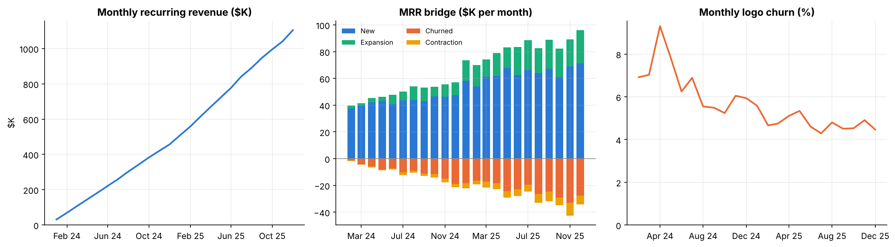
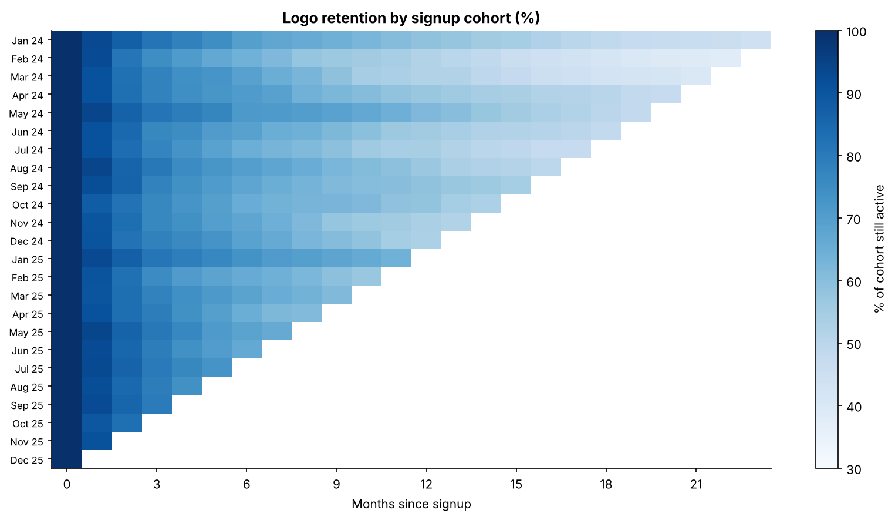
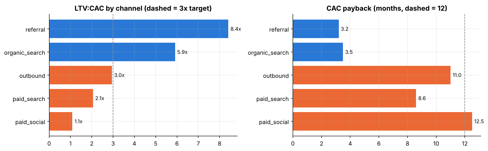

# Customer Retention & LTV Optimization

**End-to-end analytics case study: SQL → Python → interactive dashboard → ROI-driven recommendations.**



> **Dashboard:** open [`dashboard/index.html`](dashboard/index.html) in a browser (self-contained, works offline). Tableau / Power BI extracts and publishing steps: [`dashboard/interactive_link.txt`](dashboard/interactive_link.txt).
> **Executive deck:** [`docs/executive_deck.pdf`](docs/executive_deck.pdf) · **BRD:** [`docs/business_requirements.md`](docs/business_requirements.md)

## 1. Business context and problem

A B2B SaaS company ("Nimbus") grew MRR to **$1.10M** (ARR ~$13.2M, 6,203 customers) in two years, but **~4.6% of customers cancel every month** and **32% of new customers are gone within six months**. Finance has no shared view of where revenue leaks, which acquisition channels actually pay back, or what the cheapest retention lever is.

This project builds that view and turns it into three prioritised, quantified actions.

*Data is synthetic and seeded (reproducible); it was generated with a known churn process so every stage has real signal to find. Results demonstrate method, not facts about a real company.*

## 2. Key insights and financial impact

| # | Finding | Evidence |
|---|---|---|
| 1 | **Onboarding speed is the strongest early churn signal.** Customers who finish onboarding within 3 days churn at **12.5%** within six months vs **38.0%** for everyone else (relative risk **3.0x**, 95% CI 2.7 to 3.5). | Chi-square test, logistic regression, random forest permutation importance |
| 2 | **Paid social does not pay back.** LTV:CAC is **1.1x** with a 12.5-month payback; referral returns **8.4x** and organic **5.9x**. | `unit_economics_by_channel` (SQL) |
| 3 | **Early life is where cohorts bleed.** Only 78% of a cohort is active at month 3, 68% at month 6, 56% at month 12. | Cohort retention heatmap |
| 4 | **524 high-value accounts (4.4% of MRR, $48K/month) are slipping** on recency and frequency of use. | RFM segmentation |

**Recommended actions (modelled, with stated assumptions)**

| Action | Estimated impact |
|---|---|
| Guided onboarding for 25% of customers who miss the 3-day window (~1,100 per year) | ~132 extra customers retained, 6-month churn down **2.3 pts**, **$185K** gross profit vs $45K cost (**3.1x** net ROI). Assumes only 50% of the model-adjusted effect is causal; still positive at 25% ([sensitivity](notebooks/eda_churn_modeling.ipynb)). |
| Move 20% of 2025 paid-social spend ($322K) to referral | **+$1.0M** net lifetime gross profit, even if referral converts at half its historical efficiency |
| Win back at-risk accounts | Saving 20% protects ~**$116K** of annual revenue |

> These are observational estimates. The first action should be validated with a randomised pilot before full roll-out, which is exactly the experiment design covered in the companion project, [`ab-testing-attribution`](https://github.com/adityayadav93/ab-testing-attribution).

## 3. Interactive dashboard

Executive summary (headline KPIs, MRR bridge, churn trend, region and plan slicers) on top; diagnostic view (cohort heatmap, onboarding churn, feature importance, LTV:CAC) below.

| Cohort retention | LTV:CAC by channel |
|---|---|
|  |  |

## 4. Data pipeline and methodology

```
Raw billing / usage CSVs (synthetic, seed 42)
  └─► SQL warehouse (DuckDB locally; PostgreSQL-compatible DDL & queries)
        └─► sql/analytics_queries.sql  (CTEs, LAG/LEAD, DENSE_RANK, NTILE)
              └─► Python notebook: cohorts, RFM, churn models, scenarios
                    └─► Dashboard (HTML / Tableau-ready extracts) + 5-slide deck + BRD
```

| Stage | What was done | Tools |
|---|---|---|
| Requirements | BRD with stakeholders, KPI definitions, assumptions, user stories | Markdown |
| Data modelling | 5-table schema (customers, onboarding, invoices, usage, marketing spend) | SQL DDL |
| Querying | Modular CTE queries: MRR bridge, NRR, cohorts, LTV/CAC, onboarding impact, RFM, ML feature table | SQL: `LAG`, `LEAD`, `DENSE_RANK`, `NTILE` |
| Diagnostics | Cohort retention, RFM segments, relative risk with CI, logistic regression (odds ratios), random forest (hold-out AUC **0.76 / 0.75**, top-decile lift 2.1x) | pandas, scipy, statsmodels, scikit-learn |
| Decision support | Scenario ROI with covariate adjustment, effect haircut, sensitivity table | Python |

Modelling choices worth noting: features use only first-month behaviour (no leakage), the label is censoring-aware (only cohorts with at least 7 months of history), and permutation importance is computed on raw columns so one-hot dummies do not dilute categorical drivers.

## 5. Repository structure

```
├── README.md
├── docs/
│   ├── business_requirements.md   BRD, user stories, metric definitions, assumptions
│   └── executive_deck.pdf         5-slide executive summary
├── sql/
│   ├── schema_setup.sql           table DDL
│   └── analytics_queries.sql      CTEs, window functions, aggregations
├── notebooks/
│   └── eda_churn_modeling.ipynb   executed, documented analysis
├── dashboard/
│   ├── index.html                 interactive dashboard (offline)
│   ├── interactive_link.txt       Tableau / Power BI publishing notes
│   └── data/                      tidy extracts for BI tools
├── src/                           data generator, warehouse build, dashboard + deck builders
├── assets/                        figures used above
├── results/metrics.json           every headline number in this README
└── data/processed/                SQL query outputs (raw data and warehouse are regenerated)
```

## 6. Reproduce it

```bash
pip install -r requirements.txt
make all          # generate data → run SQL → execute notebook → build dashboard + deck
```

Running on PostgreSQL instead: execute `sql/schema_setup.sql`, load the CSVs in `data/raw/` with `\copy`, then run the queries in `sql/analytics_queries.sql` (they use standard SQL only).

## 7. Limitations

- The LTV formula uses a constant churn rate per segment, a planning heuristic rather than a forecast.
- Marketing spend is attributed to the channel of acquired customers; shared brand spend and multi-touch effects are ignored.
- Onboarding cost ($40 per enrolled customer) is a placeholder assumption to replace with a finance estimate.
